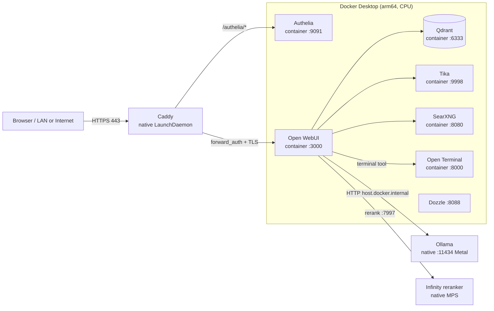

# M2 Ultra Local AI Stack (Ansible)

A self-hosted, local-first AI platform for a **Mac Studio M2 Ultra / 64 GB**, deployed
and maintained entirely with **Ansible** against the machine it runs on. It is an
Apple-Silicon adaptation of the
[2GuysTek 3×RTX-3090 AI homelab stack](https://2guystek.tv/homelab/ai/infrastructure/2026/07/31/building-my-ai-homelab-server-three-rtx-3090s):
same components and wiring, but with the GPU layer re-platformed from CUDA to Apple
**Metal/MPS** and the CPU services running as native arm64 containers.

Everything is declarative and idempotent: re-running the main playbook converges the
machine to the desired state, and dedicated playbooks cover the start/stop/uninstall
lifecycle.

---

## Table of contents

- [Purpose](#purpose)
- [Architecture](#architecture)
- [Design decisions and capacity](#design-decisions-and-capacity)
- [Repository layout](#repository-layout)
- [Prerequisites](#prerequisites)
- [Configuration reference](#configuration-reference)
- [Lifecycle operations](#lifecycle-operations)
  - [1. Deployment (install / rebuild)](#1-deployment-install--rebuild)
  - [2. Verify the deployment](#2-verify-the-deployment)
  - [3. Start the stack](#3-start-the-stack)
  - [4. Stop the stack](#4-stop-the-stack)
  - [5. Undeployment (uninstall)](#5-undeployment-uninstall)
  - [6. Operational maintenance](#6-operational-maintenance)
- [Features](#features)
  - [Models](#models)
  - [Reasoning display](#reasoning-display)
  - [Web search](#web-search)
  - [2FA edge auth](#2fa-edge-auth)
- [Secrets](#secrets)
- [Troubleshooting](#troubleshooting)
- [Known caveats / TODO](#known-caveats--todo)
- [Appendix: raw rollback commands](#appendix-raw-rollback-commands)

---

## Purpose

Provide a **local, private, agent-quality AI workstation** with no cloud dependency:

- **Chat + RAG + web search** in a polished UI (Open WebUI).
- **Fully local inference** on the M2 Ultra GPU via Metal (Ollama), including a
  70B-class model and reasoning models.
- **Retrieval-augmented generation** with a vector DB (Qdrant), document extraction
  (Tika), a self-hosted metasearch backend (SearXNG), and a GPU-accelerated reranker
  (Infinity on MPS).
- **Hardened public access** to the hostname via TOTP 2FA (Authelia) behind Caddy,
  with the app's own accounts underneath.

The project owns the **floor**: models, data, and access all live on the Mac.

---

## Architecture



**The split matters:** Docker Desktop on macOS cannot pass a GPU into containers, so
anything that needs the GPU runs **natively** (Ollama, Infinity reranker); everything
else runs in **arm64 containers**. Caddy is the pre-existing native reverse proxy,
extended with a managed site block.

### Components

| Component | Form | Endpoint / purpose |
|---|---|---|
| **Ollama** | native LaunchAgent `com.otto.ollama` | `0.0.0.0:11434`, Metal GPU; LLM + embeddings |
| **Infinity reranker** | native LaunchAgent `com.otto.infinity-reranker` | `127.0.0.1:7997`, PyTorch MPS; `BAAI/bge-reranker-v2-m3` |
| **Caddy** | native LaunchDaemon `com.otto.caddy` | `https://<ai_hostname>`; TLS, 2FA gate, reverse proxy |
| **Metal wired limit** | native LaunchDaemon `com.otto.iogpu-wired-limit` | one-shot `sysctl iogpu.wired_limit_mb=57344` |
| **Open WebUI** | container | `127.0.0.1:3000`; chat, RAG, web search, tools |
| **Qdrant** | container | internal `:6333`; RAG vector store |
| **Tika** | container | internal `:9998`; document extraction |
| **SearXNG** | container | internal `:8080`; self-hosted web search |
| **Open Terminal** | container | internal `:8000`; sandboxed shell tool |
| **Dozzle** | container | `127.0.0.1:8088`; container log viewer |
| **Authelia** | container | `127.0.0.1:9091`; TOTP 2FA portal at `/authelia/` |

Request path: **browser → Caddy (TLS) → Authelia 2FA → Open WebUI → native Ollama/
reranker and/or CPU service containers.** Only Open WebUI (via Caddy) and Dozzle-on-
localhost are exposed; everything else stays on the internal Docker network or loopback.

---

## Design decisions and capacity

- **No CUDA.** Ollama runs native on Metal; the reranker runs with `--device mps`.
  There are no NVIDIA drivers, no NVIDIA Container Toolkit, and no `:cuda` images.
- **Metal wired limit.** The default Metal cap is ~75% of 64 GB (~48 GB). The stack
  raises it to **56 GB** (`iogpu.wired_limit_mb=57344`) so a 70B Q4 fits fully on-GPU.
- **Bounded context.** Ollama 0.34 ignores `OLLAMA_CONTEXT_LENGTH` and auto-picks a
  context from VRAM; left alone it loads the 70B at its 131072 maximum, which overflows
  the wired limit and spills ~11% of layers to CPU (66 GB, `11%/89% CPU/GPU`). The play
  therefore builds derived models with a **32k context baked in**; the 70B is then
  **47 GB, 100% GPU**.
- **Reasoning-friendly.** `ollama_keep_alive: 30m` unloads a resident model after 30
  minutes so a 43 GB 70B does not pin memory forever.
- **Public hostname from DuckDNS.** A second free name (`beranci-ai.duckdns.org`) maps
  to the same home IP as the existing `beranci.duckdns.org`. DuckDNS cannot share cookies
  across separate names, so Authelia's portal lives on the **`/authelia` subpath** of the
  same name.
- **Port 80 is taken by Docker Desktop**, so the managed Caddy global option
  `http_port 8080` moves Caddy's plain-HTTP listener off :80. HTTPS/cert issuance
  (TLS-ALPN on :443) is unaffected.
- **TOTP at the edge, accounts in the app.** Caddy `forward_auth` delegates to Authelia
  (cookie sessions, so the SPA is never re-prompted); Open WebUI's own login remains
  behind it, with public signup disabled.

---

## Repository layout

```
ansible.cfg                         # inventory, roles path, vault password file, interpreter
requirements.yml                    # collections (community.general/docker, ansible.posix)
inventory/
  hosts.yml                         # local connection to this Mac
  group_vars/all/main.yml           # non-secret configuration (see reference below)
  group_vars/all/vault.yml          # encrypted secrets (gitignored)
  group_vars/all/vault.yml.example  # template + encryption instructions
playbooks/
  site.yml                          # DEPLOY: the full idempotent install/rebuild
  preflight.yml                     # read-only environment checks
  stack-start.yml                   # start the whole stack
  stack-stop.yml                    # stop the whole stack (data preserved)
  uninstall.yml                     # remove the stack (confirm-gated)
  verify.yml                        # post-deploy functional checks
  verify-70b.yml                    # load the 70B; confirm 100% GPU
  verify-authelia.yml               # 2FA redirect + first-factor login
  verify-reasoning.yml              # reasoning models emit a thinking trace
  enable-r1-websearch.yml           # add the DeepSeek-R1 legacy-web-search model
  verify-r1-websearch.yml           # confirm DeepSeek-R1 web search returns sources
  set-websearch-default.yml         # pin the Web Search toggle to always-on
  enroll-totp.yml                   # create/rotate the Authelia TOTP device
roles/
  host/       ollama/      reranker/      authelia/
  containers/ caddy/       validate/
```

---

## Prerequisites

1. **Apple Silicon Mac** (target here: Mac Studio M2 Ultra, 64 GB, macOS).
2. **Native arm64 Homebrew** at `/opt/homebrew`. On this host `/usr/local` is x86_64 and
   the play deliberately never uses it for installs.
3. **Ansible** on the control node (this Mac). `ansible` 11.x is installed.
4. **Docker Desktop** (arm64) installed and running. Recommended: set its VM memory to
   **~8 GB** (Settings → Resources) to leave room for the 70B in unified memory.
5. **A public DuckDNS hostname** (e.g. `beranci-ai.duckdns.org`) resolving to your home
   IP, with **TCP 443 forwarded** to this Mac (ACME is completed via TLS-ALPN on :443).
   Change `ai_hostname` in `inventory/group_vars/all/main.yml` if you use a different name.
6. **Local secrets and sudo helpers:**
   - `~/.vault_password.txt` — the Ansible Vault password (referenced by `ansible.cfg`).
   - `~/.ansible_become_pass` — sudo password file for `--become-password-file`
     (needed by deployment and by start/stop/uninstall, because Caddy runs as root).
7. **`~/Caddyfile`** — your existing Caddy config (e.g. Jellyfin). The play inserts two
   clearly-marked managed blocks and never removes your own sites.

---

## Configuration reference

All non-secret settings live in **`inventory/group_vars/all/main.yml`**:

| Variable | Default | Meaning |
|---|---|---|
| `ai_hostname` | `beranci-ai.duckdns.org` | Public hostname (DuckDNS name) |
| `ai_base_dir` | `~/ai-box` | Persistent data root (configs, DBs) |
| `ai_uid` / `ai_gid` | host uid/gid | Lets the Authelia container read its `0600` files |
| `ollama_host_port` | `11434` | Ollama API port |
| `webui_port` | `3000` | Open WebUI (loopback only) |
| `reranker_port` | `7997` | Infinity reranker (loopback only) |
| `dozzle_port` | `8088` | Dozzle log viewer (loopback only) |
| `ollama_models` | see file | Base models to pull |
| `ollama_chat_models` | see file | Derived `<name>` from `<base>` with 32k context |
| `ollama_context_length` | `32768` | Context baked into derived models |
| `ollama_keep_alive` | `30m` | Idle unload timeout (`-1` = never) |
| `iogpu_wired_limit_mb` | `57344` | Metal wired limit (56 GB) |
| `reranker_model` | `BAAI/bge-reranker-v2-m3` | Cross-encoder reranker |
| `reranking_engine` | `external` | `external` (Infinity/MPS) or `local` (built-in) |
| `open_terminal_enabled` | `true` | Include the Open Terminal tool container |
| `dozzle_enabled` | `true` | Include the Dozzle log viewer |
| `authelia_enabled` | `true` | Edge TOTP 2FA |
| `caddy_basic_auth_enabled` | `false` | Legacy HTTP basic auth (off; see caveats) |
| `webui_enable_signup` | `false` | Disable public account creation |
| `*_image` | floating tags | Container images (pin versions for reproducibility) |

**Vault keys** (`inventory/group_vars/all/vault.yml`): `webui_secret_key`,
`searxng_secret`, `open_terminal_api_key`, `webui_admin_name`, `webui_admin_email`,
`webui_admin_password`, `authelia_session_secret`, `authelia_storage_encryption_key`,
`authelia_jwt_secret`, `authelia_user`, `authelia_user_displayname`,
`authelia_user_email`, `authelia_user_password`, `authelia_user_password_hash`, and the
(disabled) `caddy_basic_auth_*`.

---

## Lifecycle operations

> **Convention.** Run all commands from the repository root (so `ansible.cfg` is picked
> up). Commands that escalate privileges pass
> `--become-password-file ~/.ansible_become_pass`; use `--ask-become-pass` instead if you
> prefer an interactive prompt.

### 1. Deployment (install / rebuild)

`playbooks/site.yml` is the idempotent installer. It runs, in order: `host` (dirs, Metal
wired-limit daemon, Docker check) → `ollama` (install, LaunchAgent, pull models, build
`-32k` variants) → `reranker` (venv + Infinity on MPS) → `authelia` (2FA config) →
`containers` (compose stack) → `caddy` (TLS site + `forward_auth`) → `validate`.

```sh
# 0) (once) sanity-check the machine — read-only
ansible-playbook playbooks/preflight.yml

# 1) deploy / reconcile everything
ansible-playbook playbooks/site.yml --become-password-file ~/.ansible_become_pass
```

A bare-metal first run downloads tens of GB of models (the 70B Q4 alone is ~43 GB) and
installs PyTorch for the reranker, so it can take a while.

**Post-install feature steps** (these are separate playbooks, not part of `site.yml`):

```sh
# add the DeepSeek-R1 web-search model and restart Open WebUI once
ansible-playbook playbooks/enable-r1-websearch.yml

# keep the Web Search toggle on across model switches (hard-reload the tab after)
ansible-playbook playbooks/set-websearch-default.yml

# create the Authelia TOTP device (scan the QR it writes)
ansible-playbook playbooks/enroll-totp.yml
```

Full rebuild from a clean machine: perform [Undeployment](#5-undeployment-uninstall)
first, then re-run the commands above.

### 2. Verify the deployment

```sh
ansible-playbook playbooks/verify.yml            # Ollama, WebUI, reranker, GPU
ansible-playbook playbooks/verify-70b.yml        # loads ~47 GB; confirms 100% GPU
ansible-playbook playbooks/verify-authelia.yml   # 2FA redirect + first-factor login
ansible-playbook playbooks/verify-reasoning.yml  # reasoning models emit thinking
ansible-playbook playbooks/verify-r1-websearch.yml  # R1 web search returns sources
```

`verify.yml` prints a summary including the wired limit, reranker status, whether Ollama
is reachable from inside the Docker network, and `ollama ps` (expect `100% GPU`).

### 3. Start the stack

Lightweight start (no re-pull, no reinstall): loads the native services, starts Docker
Desktop if needed, brings up the containers, then waits for Ollama and Open WebUI.

```sh
ansible-playbook playbooks/stack-start.yml --become-password-file ~/.ansible_become_pass
```

`stack-start` uses `launchctl bootstrap` + `kickstart -k` for Ollama, the reranker, and
Caddy, so it also recovers from a partially-loaded state. `playbooks/site.yml` is a valid
heavier alternative that also reconciles configuration.

### 4. Stop the stack

Stops the containers and unloads the native services; **all data is preserved**.

```sh
ansible-playbook playbooks/stack-stop.yml --become-password-file ~/.ansible_become_pass
```

It runs `docker compose stop` and `launchctl bootout` for `com.otto.ollama`,
`com.otto.infinity-reranker`, and `com.otto.caddy`. (The `com.otto.iogpu-wired-limit`
daemon is a one-shot and needs no start/stop; the wired limit clears on reboot.)

### 5. Undeployment (uninstall)

`playbooks/uninstall.yml` is **confirm-gated** and refuses to run without
`-e confirm_uninstall=true`. It removes containers/images/volumes and networks, unloads
native services and removes their plists, strips the managed AI blocks from `~/Caddyfile`,
and (optionally) removes the Caddy service and deletes data.

```sh
# dry refusal check (safe): exits with a clear message and changes nothing
ansible-playbook playbooks/uninstall.yml

# remove the stack, keep Caddy + data
ansible-playbook playbooks/uninstall.yml -e confirm_uninstall=true \
  --become-password-file ~/.ansible_become_pass

# variants
#   -e wipe_data=true          delete ~/ai-box and ~/.ollama/models (~118 GB)
#   -e remove_caddy=true       also remove the Caddy service (else kept for Jellyfin)
#   -e reset_wired_limit=true  reset iogpu.wired_limit_mb to 0
```

Notes:
- The **Caddy global `http_port 8080` block is kept** when Caddy is kept (Docker Desktop
  owns :80, so removing it would break Caddy startup); it is removed only with
  `-e remove_caddy=true`.
- The AI site block is always removed and Caddy is reloaded for the remaining
  (Jellyfin) sites.
- `wipe_data=true` is destructive and irreversible — back up first (see below).

### 6. Operational maintenance

**Health / status at a glance**

```sh
ansible-playbook playbooks/verify.yml
docker compose -f ~/ai-box/docker-compose.yml ps
tail -n 50 ~/ai-box/logs/ollama.err.log
tail -n 50 ~/ai-box/logs/infinity-reranker.err.log
tail -n 50 ~/ai-box/logs/caddy.err.log
docker logs --tail 100 open-webui
```

**Add or change models** — edit `ollama_models` / `ollama_chat_models` in
`inventory/group_vars/all/main.yml`, then reconcile:

```sh
ansible-playbook playbooks/site.yml --become-password-file ~/.ansible_become_pass
```

Existing models are skipped, new ones are pulled, and new `-32k` variants are created
(they share blobs, so they cost no extra disk).

**Rotate the Authelia TOTP device**

```sh
ansible-playbook playbooks/enroll-totp.yml   # removes the old device, writes a new QR
open ~/ai-box/authelia/otto-totp.png         # scan into your authenticator
```

**Change the Authelia first-factor password**

```sh
# 1) generate a new argon2id hash
docker run --rm --entrypoint authelia authelia/authelia:latest \
  crypto hash generate argon2 --no-confirm --password 'NEW-PASSWORD'
# 2) put the hash in vault.yml as authelia_user_password_hash
#    and the plaintext as authelia_user_password, then:
ansible-playbook playbooks/site.yml --become-password-file ~/.ansible_become_pass
# (the authelia role restarts the container because its config file changed)
```

**Back up** the things that matter (configs + data; model weights are re-downloadable):

```sh
tar czf ~/ai-box-backup-$(date +%F).tgz -C ~ ai-box inventory/group_vars/all/vault.yml Caddyfile
# model weights, if you want to avoid re-pulling ~118 GB:
#   rsync -a ~/.ollama/models/ /Volumes/backup/ollama-models/
```

**Restore** is the reverse: place the files back, then run `site.yml`.

**Docker Desktop memory** is not scriptable — set it once in Settings → Resources
(~8 GB recommended on a 64 GB machine).

---

## Features

### Models

Base models are pulled for use and reference (`llama3.3:70b-instruct-q4_K_M`,
`qwen2.5:32b`, `llama3.1:8b`, `mxbai-embed-large`, plus reasoning models `qwen3:32b`
and `deepseek-r1:32b`). The play also creates derived models with a **32k context baked
in**:

- `llama3.3-70b-32k`
- `qwen2.5-32b-32k`
- `llama3.1-8b-32k`
- `qwen3-32b-32k` (reasoning)
- `deepseek-r1-32b-32k` (reasoning)

**Use these `-32k` variants in Open WebUI.** At 32k the 70B is fully resident
(47 GB, 100% GPU); the derived models share blobs with the base models and add no disk
usage. Expect roughly 10–15 tok/s for the 70B and 20–30 tok/s for 32B models.

### Reasoning display

The reasoning models (`qwen3-32b-32k`, `deepseek-r1-32b-32k`) emit a separate
chain-of-thought that Open WebUI renders in a collapsible **Thinking** panel. Ollama
returns it as `message.thinking`; Open WebUI shows it above the answer. Qwen3 thinks by
default (add `/no_think` to the prompt to disable); reasoning uses many more tokens,
which is why the bounded 32k context matters. Verify with
`ansible-playbook playbooks/verify-reasoning.yml`.

### Web search

Web search is SearXNG-backed and enabled server-side (`web.search.enable=true`, engine
`searxng`, `searxng_query_url=http://searxng:8080/search`). It fires when the **Web
Search toggle is on in the chat composer** (the request then carries
`features.web_search=true`). Two ways this is made reliable:

- **Keep the toggle on.** `playbooks/set-websearch-default.yml` sets the user UI setting
  `ui.webSearch = "always"`, so the toggle stays on across model switches. Hard-reload the
  Open WebUI tab afterwards. For all/new users, set the same value in the admin default
  `ui.default_interface_settings`.
- **Make DeepSeek-R1 work.** Ollama tags R1 as tool-capable, so Open WebUI picks *native
  tool calling* — which R1, a weak tool-caller, doesn't use. Classic *injected* search
  only runs when a model's `function_calling` param is `legacy`.
  `playbooks/enable-r1-websearch.yml` creates a model **"DeepSeek R1 32B (Web Search)"**
  with `function_calling: legacy` (and restarts Open WebUI so it is resolvable). Select
  that model and turn on Web Search; `playbooks/verify-r1-websearch.yml` confirms a
  `sources` array is returned. Qwen3 keeps native tool calling and is unaffected.

### 2FA edge auth

Open WebUI has no native 2FA, so TOTP is enforced at the edge by **Authelia** via Caddy
`forward_auth` (cookie sessions — no per-request prompting). The portal is at
`https://<ai_hostname>/authelia/`.

- **First factor:** username **`otto`** (the Authelia username, *not* the email),
  password `authelia_user_password` (in the vault).
- **Second factor:** the TOTP device is pre-registered by
  `playbooks/enroll-totp.yml`, which bypasses the web UI's email identity-verification
  step. Scan `~/ai-box/authelia/otto-totp.png` (or the otpauth URL in
  `otto-totp-url.txt`) into your authenticator.
- **Then** Open WebUI's own login appears: `otto.beranek@gmail.com` /
  `webui_admin_password` (in the vault).

Authelia runs single-instance with the in-memory session store (no Redis). The
`/authelia` path is the only unauthenticated route; everything else requires a valid 2FA
session. Disable the layer with `authelia_enabled: false`.

The notifier is **filesystem-only**, so Authelia's identity-verification codes (password
reset or device management from the portal) are written to
`~/ai-box/authelia/notification.txt` instead of being emailed. Configure an SMTP
`notifier` in `roles/authelia/templates/configuration.yml.j2` if you want real email.

---

## Secrets

Everything sensitive lives in `inventory/group_vars/all/vault.yml`, encrypted (AES256)
with `~/.vault_password.txt`. `ansible.cfg` sets `vault_password_file`, so playbooks
decrypt transparently.

```sh
ansible-vault view  inventory/group_vars/all/vault.yml --vault-password-file ~/.vault_password.txt
ansible-vault edit  inventory/group_vars/all/vault.yml --vault-password-file ~/.vault_password.txt
```

- The Open WebUI headless admin (`webui_admin_*`) is created only when the database has
  **no users**; on an existing instance you log in with the account already created.
  `ENABLE_SIGNUP=false` keeps the public site locked down.
- Rendered `~/ai-box/docker-compose.yml` and `~/ai-box/searxng/settings.yml` contain
  secrets and are written mode `0600`.
- Authelia's `~/ai-box/authelia/{configuration.yml,users_database.yml}` are mode `0600`
  (the container runs as your host uid so it can read them).
- The `vault.yml` file is gitignored; commit an encrypted copy if you want it versioned.

---

## Troubleshooting

| Symptom | Cause / fix |
|---|---|
| `Model not found` in Open WebUI after creating a model via API | Open WebUI caches `app.state.MODELS`; restart it: `docker restart open-webui` (the `enable-r1-websearch` play does this automatically). |
| Caddy won't start / port conflict | Docker Desktop owns host `:80`. The managed global option `http_port 8080` avoids it; don't remove that block while keeping Caddy. |
| Reranker unhealthy | Check `~/ai-box/logs/infinity-reranker.err.log`. The play installs `infinity-emb[torch,server]` with `click<8.2` and runs `--no-bettertransformer`; if it still fails it falls back to Open WebUI's built-in reranker (`RAG_RERANKING_ENGINE=local`). |
| Web search ignored by a model that should support it | Enable the Web Search toggle (see [Web search](#web-search)); for DeepSeek-R1 use the "DeepSeek R1 32B (Web Search)" model. |
| 2FA portal asks for an emailed code | The notifier is filesystem-only; the code is in `~/ai-box/authelia/notification.txt`. Normal logins only need the TOTP code. |
| `site.yml` fails with `undefined` secret | The vault is missing or the wrong password file. See [Secrets](#secrets). |
| Sudo prompts / root tasks skipped | Pass `--become-password-file ~/.ansible_become_pass` (start/stop/uninstall check this explicitly now). |
| Slow generation / CPU spill | Confirm `ollama ps` shows `100% GPU`; use the `-32k` models and keep the Docker Desktop VM ~8 GB. |

---

## Known caveats / TODO

- **HTTP basic auth is off** (`caddy_basic_auth_enabled: false`). With Open WebUI's SPA,
  cached basic-auth credentials don't cover XHR/WebSocket/service-worker requests, so
  Chrome re-prompts on nearly every request. Edge auth is Authelia TOTP instead.
- Container image tags are **floating** (`:main`, `:latest`). Pin explicit versions for
  reproducibility.
- `OLLAMA_CONTEXT_LENGTH` is ignored by Ollama 0.34 (VRAM-based default) — hence the
  derived `-32k` models.
- `OLLAMA_HOST=0.0.0.0` exposes `:11434` on the LAN. Add a `pf` rule or keep the Mac on
  a trusted network if that matters.
- `open-terminal` is an admin-level shell. It is not published to the host and sits
  behind 2FA + Open WebUI auth; keep it that way.
- The **notifier is filesystem-only**; add SMTP if you want real email from Authelia.
- Docker Desktop VM memory is **not scriptable**; set it once manually.
- Disk: models are ~118 GB under `~/.ollama/models`; `~/ai-box` is ~1.2 GB.

---

## Appendix: raw rollback commands

Equivalent to a default `uninstall.yml` (keep Caddy and data), if you prefer to do it by
hand:

```sh
# containers, images, networks
docker compose -f ~/ai-box/docker-compose.yml down --rmi all --volumes --remove-orphans

# native services
launchctl bootout gui/$(id -u)/com.otto.ollama || true
launchctl bootout gui/$(id -u)/com.otto.infinity-reranker || true
rm -f ~/Library/LaunchAgents/com.otto.ollama.plist \
      ~/Library/LaunchAgents/com.otto.infinity-reranker.plist
sudo launchctl bootout system/com.otto.iogpu-wired-limit || true
sudo rm -f /Library/LaunchDaemons/com.otto.iogpu-wired-limit.plist

# keep Caddy for Jellyfin: unload, strip the managed AI blocks from ~/Caddyfile, reload
sudo launchctl bootout system/com.otto.caddy || true
#   remove the "# BEGIN/END ANSIBLE MANAGED AI STACK" block (and the GLOBAL block only
#   if you are also removing Caddy)
sudo launchctl bootstrap system /Library/LaunchDaemons/com.otto.caddy.plist
sudo launchctl kickstart -k system/com.otto.caddy
```
